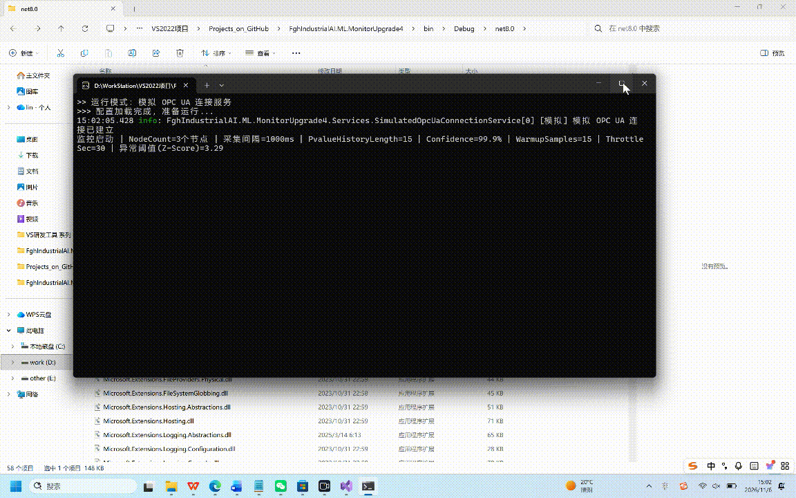

# 🏭 IndustrialAI.Monitor: 工业设备智能监控与异常预警系统

基于 .NET 8、OPC UA 与 ML.NET 构建的工业级实时监控与异常预警原型系统，专为智能焊接、机械臂等工业场景设计。

## 📖 项目背景
在工业现场，传统的阈值告警（如 `if(temp > 100) alarm`）极易因为设备的正常波动产生误报，或者因为阈值设置不合理产生漏报。本项目构建了**“滑动窗口统计 + 机器学习双模态”**的架构，不仅能精准抓取传感器异常尖峰，还能在报警时输出直观的统计特征，打破 AI 黑盒。

## ✨ 核心架构亮点

1. **分层解耦与多节点隔离**：
   通过 `ConcurrentDictionary` 对多个工业节点（温度、压力、电流）的状态进行隔离。结合 `ThreadLocal` 管理时间序列预测引擎（`TimeSeriesPredictionEngine`），确保在多线程并发采集场景下的绝对线程安全和状态连续性。
2. **双模态异常检测（打破AI黑盒）**：
   - **白盒防线（滑动窗口）**：实时计算窗口内的均值、标准差和 Z-score，输出到结构化日志中，方便现场工程师直观理解数据分布。
   - **黑盒防线（ML.NET IidSpikeDetector）**：动态适应数据分布变化，利用 P-value 抓取隐性异常尖峰。
3. **工业级预警节流与结构化日志**：
   基于 `ILogger` 的结构化日志（Structured Logging）设计，完美对接 ELK 或 Seq。并内置了“同一节点 N 秒内只报警一次”的节流机制，防止异常持续发生时的日志洪水。
4. **双数据源无缝切换**：
   在 `appsettings.json` 中通过一行配置（`UseSimulator: true/false`），即可在“真实 OPC UA 服务器”与“内置仿真数据源”之间无缝切换，实现无硬件条件下的快速开发与演示。

## 🚀 快速运行

**无需任何本地配置！** 只要确保您的电脑安装了 [.NET 8 SDK](https://dotnet.microsoft.com/download/dotnet/8.0)，即可直接在控制台看到实时数据采集、统计特征打印以及异常尖峰预警（项目默认已开启内置仿真数据源，无需连接真实的 OPC UA 硬件）。

```bash
# 1. 克隆项目
git clone https://github.com/FengGuohua319/FghIndustrialAI.ML.MonitorUpgrade4.git

# 2. 进入项目目录
cd FghIndustrialAI.ML.MonitorUpgrade4

# 3. 一键运行（默认启动内置模拟数据源）
dotnet run
```

## 📸 运行演示

<p align="center">
  
</p>